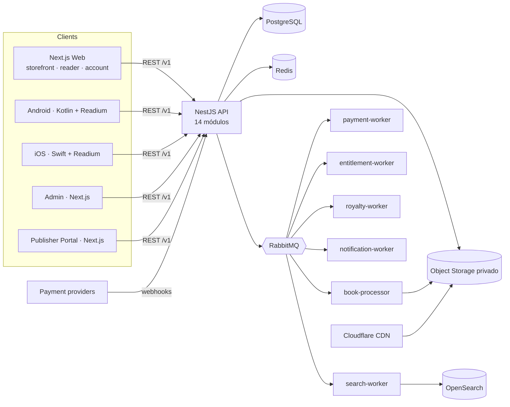
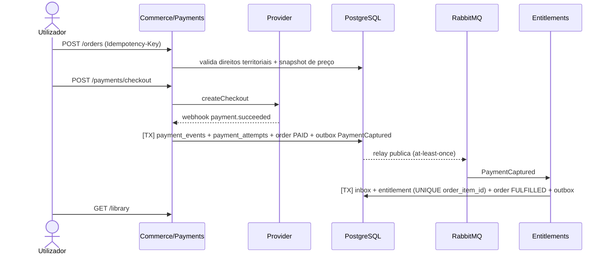

# ARCHITECTURE

Livraria digital global com marketplace de editoras/autores, compra individual, direito de leitura permanente e leitor integrado. Monólito modular + workers independentes ([ADR-0001](../adr/0001-modular-monolith.md)).

## C4 — Contentores

## Módulos e dependências permitidas
`Identity` ← todos · `Catalog` ← Commerce, Reading, Search · `Content` → Storage · `Publisher` → Catalog, Royalty · `Commerce` → Catalog, Payments (porta) · `Payments` → *eventos* → `Commerce`/`Entitlements` · `Entitlements` ← Reading, Content (autorização) · `Royalty` ← eventos de Commerce · `Audit` ← todos (só escrita).
Regra: **nenhum módulo escreve em tabelas de outro**; integração por interface pública ou evento.

## Fluxo de compra (resumo; detalhe em `docs/commerce/COMMERCE_SPEC.md`)

## Leitura e sincronização
Progresso por (utilizador, edição) com `version`. `PUT /reading/:id/progress` com `base_version`; se ≠ versão do servidor → **409** com estado canónico, e o cliente decide (por defeito: mantém o mais avançado de forma explícita, nunca sobrescreve em silêncio).

## Publicação de livro
Publisher cria edição (DRAFT) → pede upload pré-assinado → `book-processor` (antivírus → validação → metadados) → admin aprova (verifica contrato/territórios) → PUBLISHED → indexação em OpenSearch.
